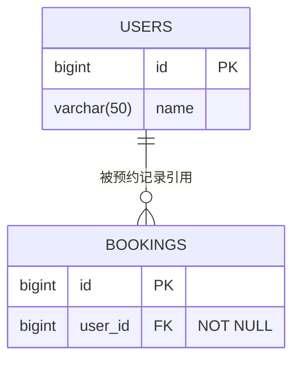

# 图表

## 类型和交付

| 目的 | 默认语法 |
|---|---|
| 业务、算法流程 | `flowchart TD` |
| 模块划分、系统结构 | `flowchart LR` |
| 数据库结构 | `erDiagram` |
| 接口和参与者交互 | `sequenceDiagram` |

每张图交付完整 Mermaid 源码（聊天用 mermaid 代码块，磁盘用 `.mmd`），修改后也给完整代码。图后不超过三行，说明图证明什么、关键路径与证据限制。需要具体坐标、厂商图标或手动编辑布局时使用 draw.io。

默认每张图不超过 9 个业务节点。流程按节点数、ER 按实体数、时序按参与者数计算，不把字段或消息算为节点。超过时拆总览和多张细节图；图注解释边界与跨图关联，不能通过删表、漏字段或断掉关系满足数量限制。真实状态流转必须以材料为依据。

## ER 规则

- 优先读 CREATE TABLE/迁移，其次 ORM 映射和业务代码。实体类没有给出的数据库长度、唯一性、默认值、可空性都标为未知；不能声称得到完整建表约束。
- 保留原字段、类型和确有的长度/精度，如 `varchar(50)`、`decimal(10,2)`。`bigint`、`datetime` 不强补长度。Mermaid 不接受的类型字符用合法别名，并在图下提供原始类型对照，不能丢精度信息。
- PK、FK、UK 有证据才标；同列可用 `PK, FK`。复合键列均标注并在图注说明联合含义。
- 每条关系写出基数、角色名和依据。`||--o{` 表示父实体恰好一个、子实体零到多个；可空外键通常用 `|o` 的可选父端。外键是否唯一影响一对一/一对多。不要只凭表名确定基数。
- 未声明 FK 的 `user_id` 可列为“推断业务关联，待确认”，不能标成数据库强制 FK。需要展示时在独立业务关系图里画，并明确推断；物理 ER 保持原样。
- 多对多若实际有中间表，应画真实中间表和两个一对多；只有概念模型才直接用 `}o--o{`。跨细节图保持同一实体标识与字段字典。

例如，只有下列声明时：

```sql
CREATE TABLE users (id BIGINT PRIMARY KEY, name VARCHAR(50));
CREATE TABLE bookings (
  id BIGINT PRIMARY KEY, user_id BIGINT NOT NULL,
  FOREIGN KEY (user_id) REFERENCES users(id)
);
```

可输出：



这张图说明每条预约必须引用一个用户；用户可以暂无预约。字段和关系来自给定 SQL，未增加业务功能。

## 渲染与可编辑文件

先检测已有 Mermaid 渲染器（如 `mmdc`）、浏览器或文档工具。CLI 可用时运行 `mmdc -i input.mmd -o output.svg`，打开图像检查标签和箭头；失败后先看实际解析错误并修复，不能声称仅保存源码就验证了语法。没有渲染能力时交付源码并说明未渲染；在线工具只作为用户可选替代，不自动上传私人结构。

draw.io 可直接生成 UTF-8 `.drawio`，基本结构如下，扩展时为每个节点使用不同 ID，并给连线设置 `source`、`target`：

```xml
<mxfile host="app.diagrams.net">
  <diagram id="architecture" name="架构">
    <mxGraphModel><root>
      <mxCell id="0"/>
      <mxCell id="1" parent="0"/>
      <mxCell id="web" value="前端" style="rounded=1;whiteSpace=wrap;html=1;" vertex="1" parent="1">
        <mxGeometry x="40" y="40" width="140" height="60" as="geometry"/>
      </mxCell>
    </root></mxGraphModel>
  </diagram>
</mxfile>
```

使用 XML 库转义标签内容并解析重开文件，检查所有端点存在；在 draw.io 中“文件 → 打开”即可编辑，XML 解析成功只证明结构可读。SVG 为矢量输出；PNG 要按最终印刷尺寸计算像素，例如宽 6 英寸、300 DPI 需要宽 1800 像素，不能只改 DPI 元数据。
